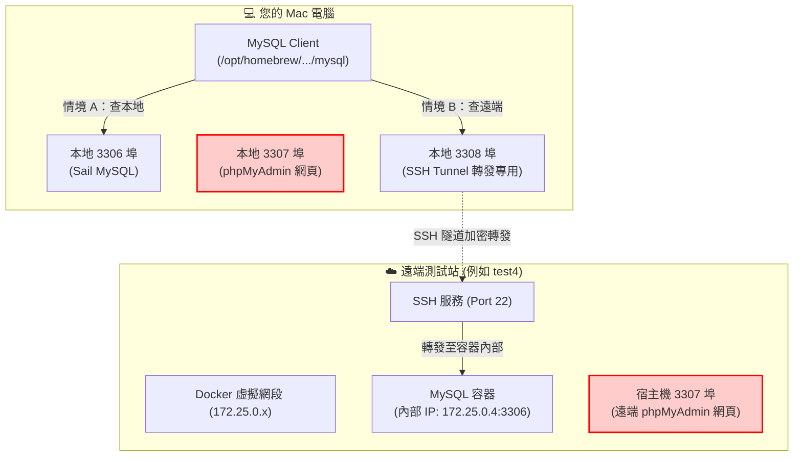

# 遠端與本地 MySQL 查詢實戰指南 (給開發者閱讀)

> 本文件是專為開發者整理的**資料庫安全查詢手冊**。若需檢視 AI Agent 執行的標準化流程與約束，請參閱同目錄下的 [SKILL.md](./SKILL.md)。

無論是要查詢自己電腦上的本地 Sail 資料庫，還是要連線到遠端測試站（例如印度四方的 `test4`），只要跟著本文的步驟操作，就能避免各種連接埠衝突與連線中斷問題。

---

## 🎯 核心概念：連線架構圖解



---

## 🚨 新手必讀避坑指南（三大常見地雷）

### 地雷 1：千萬不要連 `3307`！那是網頁，不是資料庫
* **現象**：連線時出現 `ERROR 2013 (HY000): Lost connection to MySQL server at 'reading initial communication packet'`。
* **原因**：不論是本地 Sail 還是遠端測試站，**`3307` 埠都是分配給 phpMyAdmin 的網頁伺服器（Apache HTTP）**。拿 MySQL 客戶端去連網頁伺服器，協定不合，對方會直接把連線掐斷。
* **結論**：本地 MySQL 請找 **`3306`**；遠端轉發請找 **`3308`**。

### 地雷 2：什麼是「Docker IP 漂移」？
* **現象**：昨天明明能連遠端測試站，今天重啟後突然連不上了。
* **原因**：遠端伺服器上的 MySQL 是跑在 Docker 容器內，容器每次重啟或重新部署時，Docker 分配給它的虛擬 IP 可能會改變（例如原本是 `172.25.0.6`，重啟後變成 `172.25.0.4`）。
* **結論**：連線前若發現斷線，先查一下容器當前的內部 IP（見後文步驟一鍵指令）。

### 地雷 3：`.cnf` 設定檔的格式陷阱
MySQL 的客戶端設定檔格式要求很嚴格：
1. **必須有 `[client]` 標頭**：沒有寫這行，後面的設定全被忽略。
2. **絕對不能加雙引號或單引號**：`host="127.0.0.1"` 會導致連線失敗，引號會被當成字元。
3. **註解必須自成一行**：不能在設定值後方寫註解（如 `port=3306 # 這是埠號` 會導致解析錯誤）。

---

## 🛠️ 準備工作：設定檔建立教學

為了避免在命令列中暴露明文密碼，建議在個人家目錄（`$HOME`）下建立兩份設定檔：

### 1. 本地連線設定檔：`~/.my-test0.cnf`
使用文字編輯器建立 `~/.my-test0.cnf`，貼上以下內容：
```ini
[client]
host=127.0.0.1
port=3306
user=ai_readonly
password=AiReadOnly_2026
database=paymentplatform
```

### 2. 測試站連線設定檔：`~/.my-test4.cnf`
使用文字編輯器建立 `~/.my-test4.cnf`，貼上以下內容（連接本地 3308 Tunnel 轉發）：
```ini
[client]
host=127.0.0.1
port=3308
user=ai_readonly
password=YOUR_REMOTE_PASSWORD
database=paymentplatform
```
*(請將權限設定為只有自己可讀：`chmod 600 ~/.my-test*.cnf`)*

---

## 🚀 實戰操作手冊

### 情境 A：查詢本地開發環境（Sail）
本地容器已經將 3306 映射出來，直接執行即可查詢：

```bash
/opt/homebrew/opt/mysql-client/bin/mysql --defaults-extra-file="$HOME/.my-test0.cnf" \
  -e "SELECT u.id, u.account, o.secret_key FROM users AS u JOIN user_options AS o ON o.user_id = u.id WHERE u.account = 'merchant';"
```

---

### 情境 B：查詢遠端測試站（以 test4 印度四方站為例）

遠端站台因為防火牆安全考量，不會對外開放 3306，我們需要透過 **SSH Tunnel** 轉發。

#### 第一步：確認遠端 MySQL 容器的內部 IP（防範 IP 漂移）
在 Mac 終端機執行此行指令，它會自動抓出遠端 MySQL 容器當前的虛擬 IP：
```bash
ssh test4 "awk '{print \$1, \$2}' /proc/\$(pgrep -o mysqld)/net/fib_trie | grep -B 1 '32 host' | grep -v '127.0.0.1' | head -n 1 | awk '{print \$2}'"
```
*(假設查詢出來的 IP 是 `172.25.0.4`)*

#### 第二步：在本機建立 SSH 加密隧道
使用本地未被佔用的 **`3308`** 埠進行映射（先清理舊行程）：
```bash
# 1. 關閉既有的 3308 Tunnel（避免綁定衝突）
pkill -f "3308.*test4" || true

# 2. 啟動背景隧道（把本地 3308 連到遠端的 172.25.0.4:3306）
ssh -f -N -L 127.0.0.1:3308:172.25.0.4:3306 test4
```

#### 第三步：驗證隧道是否暢通
```bash
nc -zv 127.0.0.1 3308
```
看到 `Connection to 127.0.0.1 port 3308 succeeded!` 代表連線成功！

#### 第四步：執行查詢！
```bash
/opt/homebrew/opt/mysql-client/bin/mysql --defaults-extra-file="$HOME/.my-test4.cnf" --protocol=TCP \
  -e "SELECT u.id, u.account, o.secret_key FROM users AS u JOIN user_options AS o ON o.user_id = u.id WHERE u.account = 'merchant';"
```

---

## 🩺 疑難排解（看到這個錯誤怎麼辦？）

### Q1：出現 `Lost connection to MySQL server at 'reading initial communication packet'`
* **原因 A**：您連到了 `3307`（phpMyAdmin）。請確認設定檔中的 port 是 `3306`（本地）或 `3308`（Tunnel）。
* **原因 B**：SSH Tunnel 指向的遠端 IP 錯了（IP 漂移）。請執行「第一步」重新探測遠端 IP，並重新建立 Tunnel。
* **原因 C**：`.cnf` 檔案缺少 `[client]` 標頭，或裡面的數值帶有雙引號 `""`。

### Q2：出現 `bind: Address already in use` 錯誤
* **原因**：本地已經有一個舊的 SSH Tunnel 行程卡在 3308 埠。
* **解法**：執行指令清掉它：
  ```bash
  pkill -f "3308"
  ```
  然後重新執行 SSH Tunnel 指令。

### Q3：如果本地 MySQL 沒有 `ai_readonly` 帳號？
進入 `app/code` 目錄，透過 Sail 快速建立：
```bash
./vendor/bin/sail mysql -u root paymentplatform <<'SQL'
CREATE USER IF NOT EXISTS 'ai_readonly'@'%' IDENTIFIED BY 'AiReadOnly_2026';
GRANT SELECT ON paymentplatform.* TO 'ai_readonly'@'%';
FLUSH PRIVILEGES;
SQL
```
