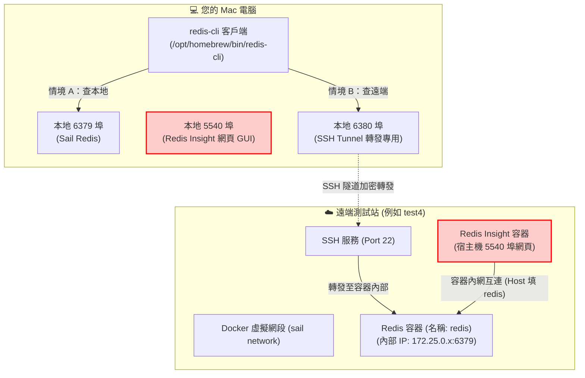

# 遠端與本地 Redis 查詢實戰指南 (給開發者閱讀)

> 本文件是專為開發者整理的 **Redis 安全查詢與視覺化連線手冊**。若需檢視 AI Agent 執行的標準化流程與約束，請參閱同目錄下的 [SKILL.md](./SKILL.md)。

無論是要查詢自己電腦上的本地 Sail Redis，還是要連線到遠端測試站（例如 `test4`），或是設定 **Redis Insight (`:5540`)** 網頁版 GUI，只要跟著本文步驟操作，就能避開連接埠衝突、Docker 網路隔離與查不到 Key 的問題。

---

## 🎯 核心概念：連線架構圖解



---

## 🚨 新手必讀避坑指南（四大常見地雷）

### 地雷 1：在 Redis Insight 網頁 (`:5540`) 新增資料庫時，填 `127.0.0.1:6379` 報錯連不上！
* **現象**：打開 `http://localhost:5540` 或遠端 `http://<測試站IP>:5540`，在 Add Database 填入 `redis://default@127.0.0.1:6379`，按下 Test Connection 卻報錯：`Could not connect to 127.0.0.1:6379, please check the connection details.`
* **原因**：**Redis Insight 本身也是跑在一個獨立的 Docker 容器內**！對容器來說，`127.0.0.1` 代表「Redis Insight 容器自己」，而不是隔壁的 Redis 容器。
* **正確解法**：因為它們都在同一個 Docker 網路（`sail`）裡，請把 Host 的 `127.0.0.1` 改成 Docker 服務名稱 **`redis`**：
  * **Connection URL 填法**：`redis://default@redis:6379`（若無密碼也可填 `redis://redis:6379`）
  * **Host 欄位**：`redis`
  * **Port 欄位**：`6379`

### 地雷 2：為什麼明明寫入 Cache 了，用 `GET` 卻永遠查到 `(nil)`？
在 Laravel 專案中，查不到 Key 99% 是因為這兩個原因：
1. **放錯 Database Index (`-n`)**：
   * **`db0` (`-n 0`，預設)**：存放 Queue、Session、臨時 Token、BAM 最後交易時間。
   * **`db1` (`-n 1`)**：**Laravel `Cache::put()` / `Cache::remember()` 預設都放在 `db1`！** 不加 `-n 1` 永遠查不到快取。
   * **`db2` (`-n 2`)**：存放 BAM 帳號異常累計等擴充狀態。
2. **漏掉 Laravel 自動前綴 (`laravel_database_`)**：
   * 程式碼裡寫 `Cache::get('site_name')`，實際存進 Redis `db1` 的完整 Key 名稱叫做 **`laravel_database_site_name`**。

### 地雷 3：千萬不要在正式或測試站跑 `KEYS *`！
* **原因**：Redis 是單執行緒模型，當資料量變大時，執行 `KEYS *` 會直接鎖死整個 Redis，導致網站所有交易與 API 瞬間卡住超時。
* **正確習慣**：一律使用非阻塞游標搜尋：
  ```bash
  SCAN 0 MATCH "*關鍵字*" COUNT 100
  ```

### 地雷 4：什麼是「Docker IP 漂移」與「變數轉義陷阱」？
* **原因**：遠端測試站的 Redis 跑在 Docker 容器裡，每次重啟容器內部 IP（如 `172.25.0.5`）可能會改變。
* **注意**：若使用 `REMOTE_REDIS_IP=$(ssh test4 ...)` 將 IP 存成變數，內層請務必使用**單引號**搭配 `grep -Eo`（見下方實戰步驟），避免外層 `$()` 把 `awk '{print $2}'` 的變數吃掉而印出 `host`。

---

## 🛠️ 準備工作：客戶端檢查與設定檔建立教學

### 0. 環境適用範圍與 `redis-cli` 檢查（macOS 專屬）
本指南與對應的 AI Skill 專為 **macOS (`Darwin`)** 環境設計。若在 **Windows 或 WSL** 環境中觸發，或是尚未安裝 `redis-cli` / 尚未建立 `~/.redis-<target>.env` 設定檔，**AI Agent 會自動暫停執行並主動詢問您要改用哪種方式查詢**。

在 macOS 本機上檢查或安裝 `redis-cli`：
```bash
# 檢查是否已安裝（支援 PATH、Apple Silicon 與 Intel Mac 路徑）
REDIS_BIN=$(command -v redis-cli || ls /opt/homebrew/bin/redis-cli /usr/local/bin/redis-cli 2>/dev/null | head -n 1)
echo "Redis CLI 路徑: ${REDIS_BIN:-未安裝}"

# 若顯示未安裝，請透過 Homebrew 安裝：
brew install redis
```

### 1. 建立本地連線設定檔：`~/.redis-test0.env`
為了避免在命令列帶 `-a` 暴露密碼，請在家目錄建立 `~/.redis-test0.env`（若本地無密碼，`REDISCLI_AUTH=` 後方留空即可）：
```bash
cat << 'EOF' > ~/.redis-test0.env
REDISCLI_HOST=127.0.0.1
REDISCLI_PORT=6379
REDISCLI_AUTH=
EOF
chmod 600 ~/.redis-test0.env
```

### 2. 建立測試站連線設定檔：`~/.redis-test4.env`
連接本地 **`6380`** SSH Tunnel 專用埠：
```bash
cat << 'EOF' > ~/.redis-test4.env
REDISCLI_HOST=127.0.0.1
REDISCLI_PORT=6380
REDISCLI_AUTH=
EOF
chmod 600 ~/.redis-test4.env
```

---

## 🚀 實戰操作手冊

### 情境 A：查詢本地開發環境（Sail）

```bash
# 載入設定檔（若無密碼則自動 unset 避免警告訊息）
set -a && source ~/.redis-test0.env && set +a
[ -z "$REDISCLI_AUTH" ] && unset REDISCLI_AUTH
REDIS_BIN=$(command -v redis-cli || ls /opt/homebrew/bin/redis-cli /usr/local/bin/redis-cli 2>/dev/null | head -n 1)

# 1. 查看各個 DB (db0, db1, db2) 有多少筆 Key
"$REDIS_BIN" -h "$REDISCLI_HOST" -p "$REDISCLI_PORT" INFO keyspace

# 2. 搜尋 db1 (Cache) 裡面的 Key
"$REDIS_BIN" -h "$REDISCLI_HOST" -p "$REDISCLI_PORT" -n 1 SCAN 0 MATCH "*quota*" COUNT 100
```

---

### 情境 B：查詢遠端測試站（以 `test4` 為例）

#### 第一步：自動抓取遠端 Redis 容器 IP 並建立 `6380` SSH Tunnel
直接複製以下三段指令到 Mac 終端機執行：
```bash
# 1. 自動抓取遠端 test4 的 Redis 容器內部 IP（單引號防吃字穩定版）
REMOTE_REDIS_IP=$(ssh test4 'grep -B 1 "/32 host LOCAL" /proc/$(pgrep -o redis-server)/net/fib_trie | grep -Eo "172\.[0-9]+\.[0-9]+\.[0-9]+" | head -n 1')
echo "遠端 Redis 容器 IP: $REMOTE_REDIS_IP"

# 2. 清理舊的 6380 Tunnel（避免殘留其他測試站如 test3/test4 的隧道）並啟動新背景隧道
pkill -f "127.0.0.1:6380:" || true
ssh -f -N -L 127.0.0.1:6380:${REMOTE_REDIS_IP}:6379 test4

# 3. 驗證本地 6380 埠是否暢通
nc -zv 127.0.0.1 6380
```
看到 `Connection to 127.0.0.1 port 6380 succeeded!` 就代表隧道通了！

#### 第二步：執行遠端查詢
```bash
set -a && source ~/.redis-test4.env && set +a
[ -z "$REDISCLI_AUTH" ] && unset REDISCLI_AUTH
REDIS_BIN=$(command -v redis-cli || ls /opt/homebrew/bin/redis-cli /usr/local/bin/redis-cli 2>/dev/null | head -n 1)

# 查看遠端各個 DB 的 Key 分布
"$REDIS_BIN" -h "$REDISCLI_HOST" -p "$REDISCLI_PORT" INFO keyspace

# 讀取遠端 db1 (Cache) 的站台名稱與支援幣別
"$REDIS_BIN" -h "$REDISCLI_HOST" -p "$REDISCLI_PORT" -n 1 GET "laravel_database_site_name"
"$REDIS_BIN" -h "$REDISCLI_HOST" -p "$REDISCLI_PORT" -n 1 GET "laravel_database_supported_currencies"
```

---

## 🩺 疑難排解（看到這個錯誤怎麼辦？）

### Q1：出現 `WRONGTYPE Operation against a key holding the wrong kind of value`
* **原因**：這個 Key 不是普通的字串（`string`），而是 `hash`、`list`、`set` 或 `zset`，所以不能直接用 `GET`。
* **解法**：先查型別，再用對應指令讀取：
  ```bash
  # 先看是什麼型別
  redis-cli -h 127.0.0.1 -p 6380 -n 1 TYPE "你的Key名稱"

  # 依型別選擇讀取指令：
  # string -> GET "Key"
  # hash   -> HGETALL "Key"
  # list   -> LRANGE "Key" 0 -1
  # set    -> SMEMBERS "Key"
  # zset   -> ZRANGE "Key" 0 -1 WITHSCORES
  ```

### Q2：出現 `bind [127.0.0.1]:6380: Address already in use`
* **原因**：已經有一個舊的 SSH Tunnel 佔用著 6380 埠。
* **解法**：執行 `pkill -f "6380"` 清理後再重新建立 Tunnel。

